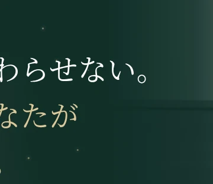
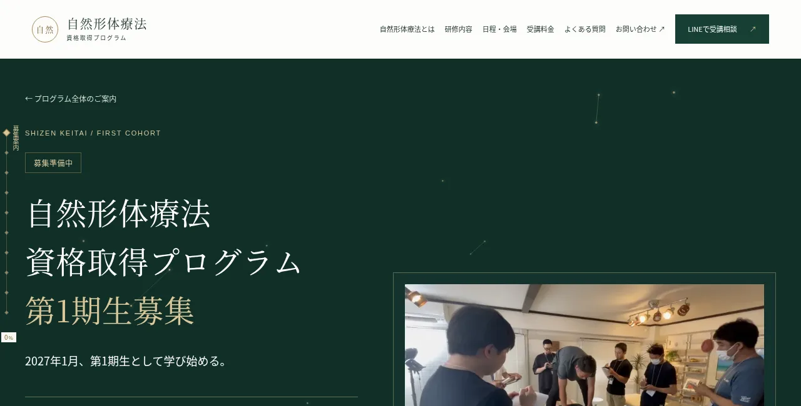
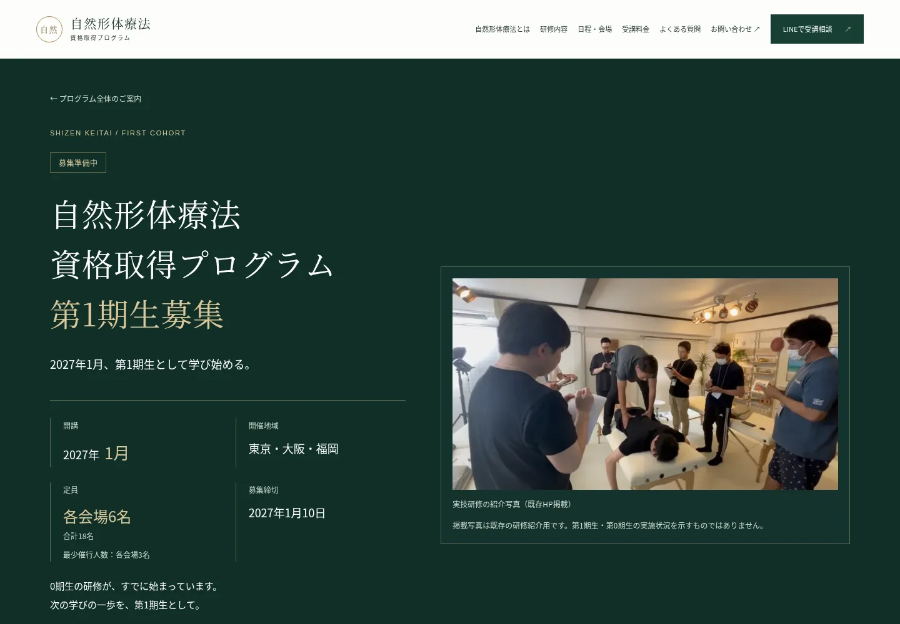
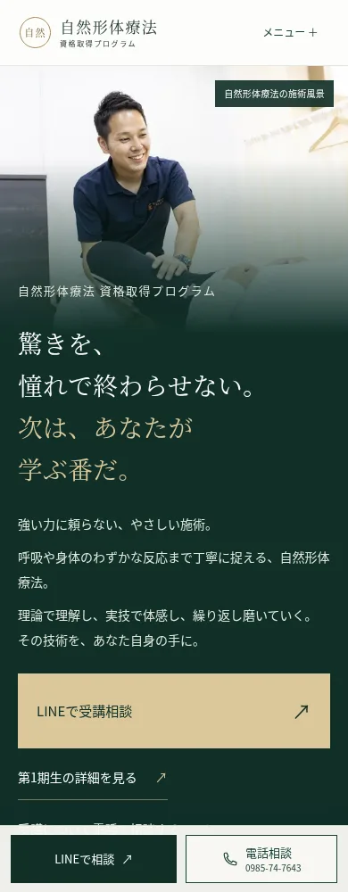
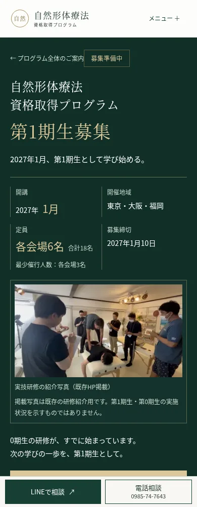
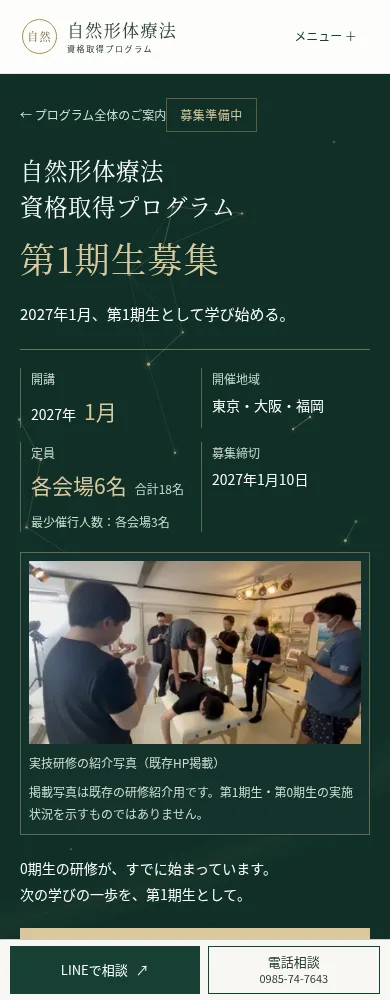

# プレミアム背景・閲覧位置ナビのレビュー

基準：main `d24dd05`。Search Console用PR #25の変更は含めない独立ブランチ。mainへのマージ・本番デプロイ・環境変数変更は未実施。

## 最新：描画禁止領域による接続線の再修正

前回は線を薄くしただけで文字周辺への描画を許しており、別レイヤーの光の帯にも細い3pxの芯線が残っていました。通常HP1280pxで接続線だけ／光の帯だけを止めて撮影し、どちらもコピーの背後を通ることを確認しました。今回は同じフェードの再調整ではなく、描ける領域そのものを限定しています。

|問題箇所・Before|問題箇所・After|
|---|---|
|||

|画面|Before|After|
|---|---|---|
|通常HP 1280px|||
|通常HP 390px|||

同じ1280×900／390×900、同じ乱数seed、動き低減の静止状態で比較。画像は元のページを撮影したもので、問題の線を画像編集で消していません。動作は別途通常モーションで検証しています。

- コピー・既存ボタンの外側24px、写真の手前56pxを接続線の描画禁止領域に設定。端点が外にあっても領域を横切る線は、線全体を描きません。禁止領域の外側24pxでも濃度を減衰し、途中で切り取る見え方を避けます。
- 接続線は最大88px（軽量時64px）、候補を安定した1/3に限定。透明度を抑え、距離フェードが十分に終わってから最大長に達するよう設定。安全な余白が狭い画面では接続線が出ない場合があります。
- 光の帯の細い芯線・輪郭ストロークを撤去し、写真から48px離れた空間の中を動く柔らかな楕円グラデーションに変更。写真境界に光が届かず、クリップで切られる直線が発生しません。柔らかな光の流れと粒子の数・速度・発光は維持。
- サイドナビ・スプラッシュ・写真／本文／ボタンの配置・配色CSS・SEO／募集情報には差分なし。
- `scripts/hero-network-clearance-browser-check.cjs`で390/1280/1440pxの両ページを検証。文字・写真の保護範囲を横切る線0、帯の輪郭ストローク0、写真内alpha=0、粒子と光の動きを確認。実測データは[clearance-review.json](clearance-review.json)。

## 前回の線フェード修正（履歴）

写真除外のハードクリップ直前まで、接続線全体が均一な透明度で描かれていたことが主因。1280pxの実DOMで、写真左端x=448pxと「な」の右端約449pxが一致しました。従来の距離式はすでに0へ連続的に減衰しており、距離しきい値だけが原因ではありません。

同じ境界・線幅での制御再現では、従来は画素のalphaが48のままx=446pxまで続き、x=447pxで突然0になりました。新しい線では48→33→17→4→1→0と減衰し、安全クリップに到達する前に透明になります。実測値と再現結果は[line-fade-review.json](line-fade-review.json)を参照。

- 接続線に位置ごとの透明度グラデーションを適用。写真手前64px、Canvas外周36pxをsmoothstepでフェードし、写真境界の正確な交点にも透明度0のストップを置きます。写真除外の安全クリップ自体は維持。
- 粒子と発光も同じ写真境界でフェード。線の距離減衰を滑らかな曲線にし、接続ごとの透明度に約0.22秒の追従を加えて、出現・消失を緩和。
- 文字領域の線は最大半分まで穏やかに抑制。境界のない背景部分の強さ、粒子の数・速度・発光、光の帯・フレーム上限は維持。
- サイドナビ・スプラッシュ・写真配置・ページ本文・ボタン・SEO／募集情報には差分なし。下記画像は構成・視認性・ノートPC対応時の比較で、線フェードの細部は最新Previewで確認してください。
- `scripts/hero-network-fade-browser-check.cjs`でPC1280px／スマホ390pxの両ページを検証。実際の接続線がすべてグラデーションであること、背景の継続的な動き、写真内のalpha=0、境界横断線の単調な減衰を確認。

## Before / After

以下は視認性・ノートPC対応時の比較履歴です。描画禁止領域を追加した最新画像は、このページ上部のBefore/Afterを参照してください。既存の画像・文章・ボタン・見出し位置を維持し、背景Canvasと左端の閲覧位置ナビだけを追加しています。

### 修正版：ノートPC 1280×650px

旧版はCSS・JavaScriptの両方で「幅1440px以上かつ高さ720px以上」を要求していたため、一般的なノートPCで非表示でした。幅1101px以上に変更し、1280px等では既存左余白内34pxのコンパクト表示・現在名の縦書きに切り替えます。高さはヘッダー実測値と項目数から間隔を自動調整。ヘッダー下に300px未満しか残らない極端に低い画面のみ非表示です。

|通常HP|募集ページ|
|---|---|
|||

|画面|Before|After|
|---|---|---|
|通常HP・1440px|||
|募集ページ・1440px|||
|通常HP・390px|||
|募集ページ・390px|||

## 背景

- Canvasの金色粒子（半径0.8〜1.9px）。移動速度の係数8〜16と緩やかな右上方向の流れを維持。接続線は現在、保護領域の外側だけで最大88px（軽量時64px）に制限。端で減衰し、再配置時は3秒でフェードイン。
- 再利用する小さな発光テクスチャと、輪郭のない柔らかな楕円の光。写真から離れた空間内をゆっくり流れ、点滅や細い帯の芯線は使いません。
- 写真コンテナーの実測領域をクリップで完全に除外。写真の位置・寸法・object-positionは変更しない。Canvasは操作を遮らない。
- 面積に応じて10〜56粒子。768px未満または論理CPU4以下では上限22、描画上限20fps、DPR上限1.5。それ以外は30fps、DPR上限2。柔らかな光も軽量時は1つ、通常2つに抑制。
- fine pointerのみ、最大7pxの穏やかな反応。位置と強さを補間して戻す。スマホでは反応なし。
- スプラッシュ中・画面外・非表示タブでループ停止。動き低減は静止画。独立した停止・再開ボタンを用意。
- ResizeObserverとresizeで再測定。Observer・イベント・RAFはアンマウント時に解除。IntersectionObserverがない場合は連続描画しない。

## 左ナビ

- 幅1101px以上で表示。1101〜1439pxでは既存左余白内34px・現在名の縦書き、1440px以上は72px・横書き。本文幅や画像を押し動かさない。ヘッダーの高さと画面高に応じてマーカー間隔を22〜32pxで調整。
- 通常HP12項目、募集ページ10項目。実在IDへリンクし、セクション追加・既存ID変更なし。
- 現在の名称だけを表示。ホバーしても展開しない。細線・小マーカー・移動する大きなひし形・0〜100%の進行率を表示。
- セクションの座標をキャッシュし、scrollのRAFで判定。ヘッダー高、12pxの境界ヒステリシス、ページ最下部を考慮。本文サイズ変更時に座標を再計算。
- クリック・Tab・Enter・ネイティブ履歴のハッシュに対応。移動先にフォーカスし、ヘッダー下に余白を確保。動き低減は即時移動。

## 検証

- 48テスト（既存37＋ナビ3件＋境界・接続フェード4件＋描画禁止領域4件）、型検査、Production Build、diffチェック成功。
- 指定7幅で両ページの横はみ出し・エラーなし。本文・既存リンク・h1位置はBefore/After一致。全画像の座標・寸法差は最大0.0625pxの小数丸め範囲、画像ソースと切り抜き位置は一致。
- 全22マーカー、キーボード、最初・最後、進行率、スムーズ移動、ホバー非展開、写真領域のCanvas透明性、静止・停止・再開、画面外停止を専用ブラウザー検証で確認。
- 修正版は1280pxでも全22マーカーのクリックを検証。1101×600 / 1152×650 / 1200×600 / 1280×650 / 1366×668 / 1440×650で表示・左余白・ヘッダー下の収まりを確認。1024px以下では非表示。
- 非表示タブはdocument.hiddenとvisibilitychangeの模擬検証。実機ブラウザーでのタブ切り替えは別途確認する。
- 通常HP10幅、募集ページ11幅、スプラッシュ5幅、既存登場演出5幅・両ページの回帰成功。
- 6ページ巡回、axe390px全6ページ・1440px両ページの違反0件。コントラスト等の人手確認項目は残る。LINE・電話はURL維持。外部メッセージ送信・通話なし。

以下の表は視認性・ノートPC対応版の測定。線フェード修正後の測定は[line-fade-review.json](line-fade-review.json)に別記しています。

|Lighthouse|Before性能|After性能|Afterアクセシビリティ|After LCP|After CLS|
|---|---:|---:|---:|---:|---:|
|通常HP|93|96|100|2.2秒|0|
|募集ページ|91|95|100|2.9秒|0|

Lighthouse 13.6.0、ローカルProduction Build、モバイル既定条件、各1回。点差を改善率・実ユーザー性能の保証として扱わない。SEOは意図的noindexの影響があり、その設定には変更なし。詳しい記録は[results.json](results.json)。

## Previewで確認すること

1280px前後で縦書きの現在名とマーカーが表示されること、1440px以上では横書きになること、全マーカーの移動先と固定ヘッダーの余白、強化した粒子・細線と斜めの光の流れ、写真上には描画されないこと、停止・再開、スマホの固定CTAとの共存を確認。初回スプラッシュ中は追加演出を隠し、終了後に開始する。

修正後のPreview URLの読み取りは実行環境のプロキシでCONNECT 403、Web取得でもアクセス不可でした。Vercel Readyと実画面での操作確認を区別し、実画面は未確認とします。ローカルで同じProduction Buildを検証しました。

再検証では並列ブラウザー負荷下でスプラッシュの時間依存アサーションが1440pxで一度失敗しました。単独再実行は全5幅・残りの全操作で成功。スプラッシュ本体の変更はありません。Canvasの画素変化を読むQA処理ではChromeがreadback性能の警告を出しますが、通常サイトは画素の読み取りを行わず、通常巡回では警告なしです。

実機Safari/iPhone、スクリーンリーダー実機、Vercel実画面は未確認。LinuxのWebKit実行環境も未導入。対応APIの機能検出とフォールバックを用意したが、実機確認の代わりにはならない。
